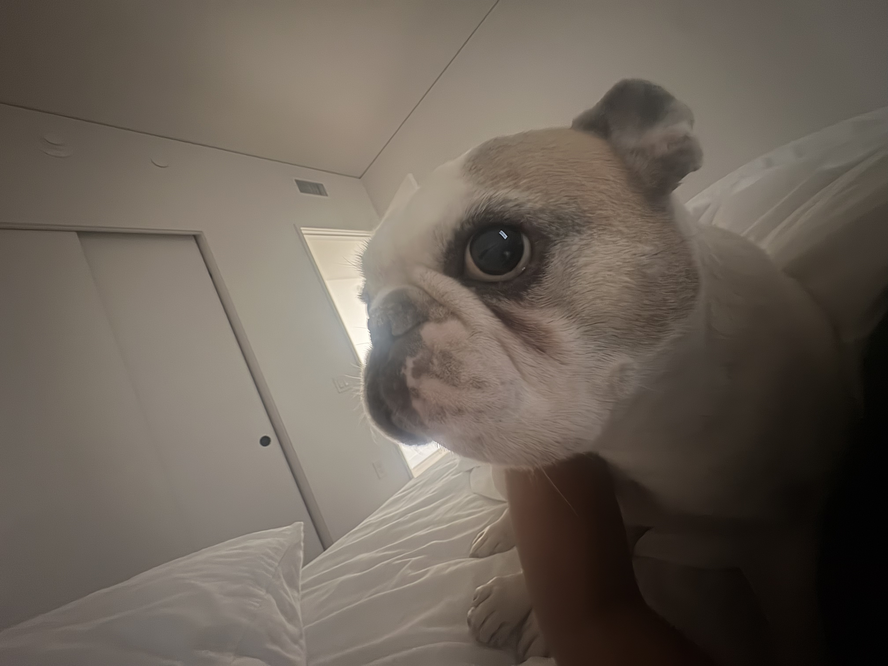

<!-- HOME: replace the name, introduction, and email below. Keep the ::: layout lines. -->
<!-- PREVIEW: first use Build > Render Website to generate every page, then Render this file. -->
:::: {.home-hero}
::: {.hero-copy}
[STUDENT / RESEARCHER / EXPLORER]{.eyebrow}

# Isabella Gomez {.display-name}

[Making sense of the social world.]{.hero-subtitle}

I'm an undergraduate at Loyola Marymount Univerty. My major is Politcial Science and I am interested in philantrophy, politics, and what we can learn from data. This website is a way to get to know me. Update.

[Take a look at my resume](research.qmd){.primary-link} [Email me ](igomez14@lion.lmu.edu){.quiet-link}
:::

::: {.hero-photo}
<!-- Replace images/profile.jpg with your photo. Update the description in fig-alt too. -->
{fig-alt="Orange flowers, a sample image for this personal website."}
:::
::::

:::: {.home-notes}
::: {.home-note}
[01 / IN THE CLASSROOM]{.eyebrow}

## Questions worth asking

How do the places we live shape our opportunities? I'm passionate about broadening my horazion and learning about different cultures .

[Academic interests & research](research.qmd)
:::

::: {.home-note}
[02 / BEYOND THE CLASSROOM]{.eyebrow}

## Learning by noticing

A new place, a good conversation, and new experiences are important parts of expanding yourself
[Read my latest notes](blog.qmd)
:::
::::
